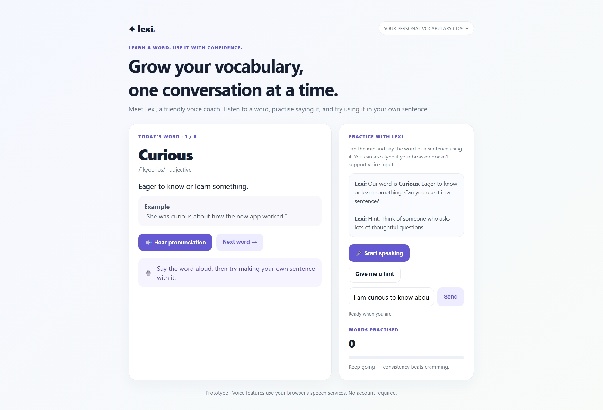

# lexi-vocabulary-coach
Lexi is a voice-enabled vocabulary learning web application that helps users improve their English vocabulary through pronunciation, speech recognition, interactive exercises, examples, and instant learning feedback.

